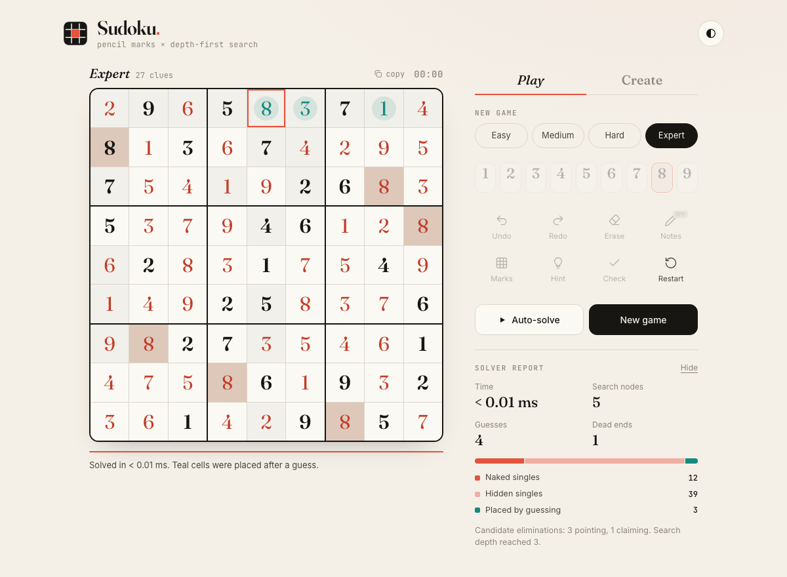

# Sudoku Solver

A Sudoku solver, generator and player that runs in the browser. It needs no server, no build step and no dependencies. Open `index.html` and play.



## Features

| | |
|---|---|
| **Generate** | New puzzles in four levels: Easy, Medium, Hard and Expert. Every puzzle has exactly one solution. |
| **Play** | Type digits, keep pencil notes, fill all candidates in one click, undo and redo, check for errors, and get hints. Each hint names the technique it used. The timer and the current game are saved locally. |
| **Create** | Enter or paste your own puzzle. Duplicate digits are marked as you type, and the editor reports whether the grid has *no*, *one* or *many* solutions, with a difficulty rating. |
| **Auto-solve** | Solves any valid grid instantly and then replays the solution cell by cell. Logical placements show in vermilion and placements made after a guess show in teal. A report lists search nodes, guesses, dead ends and the techniques used. |
| **Learn** | A **Techniques** guide explains every term with a diagram: units, peers, candidates, naked and hidden singles, pointing, claiming, naked pairs, guessing, difficulty levels and the solver report. Hint messages and solver-report labels link to the matching section. |
| **Extras** | Light and dark themes, full keyboard control, works on phones, and works offline. Fonts are the only thing loaded from the internet, and system fonts take over when you are offline. |

## Run it

```bash
open index.html            # macOS. Or double-click the file, or drag it into any browser.
```

Everything is plain `<script>` tags with no ES modules, so the page also works from `file://`. To host it, upload the folder to any static host, such as GitHub Pages, Netlify or S3.

### Keyboard

| Key | Action |
|---|---|
| `1`–`9` | Place a digit. Pressing the same digit again clears it. |
| `Shift` + `1`–`9` | Toggle a pencil note |
| `←` `↑` `→` `↓` | Move the selection |
| `Backspace` / `Delete` / `0` | Erase |
| `N` | Notes mode on/off |
| `A` | Fill all candidates |
| `H` | Hint |
| `S` | Auto-solve. Press again or `Esc` to skip the animation. |
| `?` | Open the techniques guide |
| `Ctrl/⌘ Z`, `Ctrl/⌘ ⇧ Z` | Undo / redo |

## Project layout

```
index.html              page shell, SEO metadata
assets/css/style.css    all styling (light + dark themes)
assets/og-image.png     social preview card
src/core/solver.js      core solver: no DOM, works in browser, Node and JavaScriptCore
src/core/generator.js   puzzle generator built on the solver
src/ui/app.js           UI: board, play / create modes, hints, animation
tests/run.js            core test suite
```

## Tests

```bash
node tests/run.js
# or, on macOS with nothing installed:
/System/Library/Frameworks/JavaScriptCore.framework/Versions/Current/Helpers/jsc tests/run.js
```

The suite covers well-known hard puzzles, including Arto Inkala's "world's hardest sudoku" and a 17-clue minimal puzzle. It also covers uniqueness detection, invalid and unsolvable grids, the parser, the hint engine, and puzzle generation at every level. Generation can be seeded, so results are reproducible.

## The algorithm

The solver keeps the original idea of this project, **pencil-and-paper elimination combined with depth-first search**, and reworks it for speed and correctness.

### 1. Pencil marks as bitmasks

Every empty cell stores its remaining candidates as a 9-bit integer. Bit *k* means "digit *k*+1 is still possible", so `0b000010011` means {1, 2, 5}. Each cell has 20 **peers**: the other cells in its row, column and box. Peers are computed once at load.

Placing a digit `d` in a cell does three things:

1. Write `d`.
2. Clear bit `d` from the candidates of all 20 peers.
3. If any peer is left with **zero** candidates, report a contradiction immediately.

With bitmasks, a candidate check is a single AND. Counting candidates is a lookup in a 512-entry popcount table.

### 2. Constraint propagation (the "pencil method")

Before any guess is made, the solver repeats these human techniques until none of them changes the grid:

| Technique | Rule |
|---|---|
| **Naked single** | A cell has one candidate left, so it must be that digit. |
| **Hidden single** | A digit fits in only one cell of a row, column or box, so it goes there. |
| **Locked candidates, pointing** | Inside a box, a digit's candidates all lie in one row or column. Remove that digit from the rest of that line. |
| **Locked candidates, claiming** | Inside a row or column, a digit's candidates all lie in one box. Remove that digit from the rest of that box. |
| **Naked pair** | Two cells in a unit have the same two candidates. Remove both digits from every other cell in the unit. |

Hidden singles are found without nested loops. For each unit, one pass builds two masks: `once`, the digits seen at least once, and `twice`, the digits seen at least twice. The digits that appear exactly once are then `once & ~twice & ~placed`. If a digit appears in neither `once` nor `placed`, it has nowhere to go and the position is a contradiction.

Most newspaper puzzles are solved completely in this phase, with zero guesses.

### 3. Depth-first search with MRV

If logic stalls, the solver branches:

1. Pick the empty cell with the **fewest candidates**. This is the *minimum remaining values* heuristic, and it usually picks a cell with 2 candidates, which keeps the search tree narrow.
2. For each candidate, **copy** the state, place the digit, run propagation again and recurse.
3. If a branch hits a contradiction, discard it and try the next candidate. If every candidate fails, backtrack.

Each node runs full propagation, so search trees stay tiny. The "world's hardest sudoku" takes about 60 nodes, a few milliseconds.

### 4. Counting solutions

`solve(grid, { limit: 2 })` keeps searching after the first solution and stops at the second. This one function answers "is it solvable?", "is the solution unique?" and "what is the solution?". The Create mode uses it on every keystroke.

### 5. Recording the trace

Every placement on the winning path is recorded as `{ cell, digit, how }`, where `how` is `naked`, `hidden-row`, `hidden-col`, `hidden-box` or `guess`. The trace is copied with the state at each branch. Placements from failed branches are thrown away along with their state. What remains is a clean, replayable solving order, which the UI animates and colour-codes.

### 6. Generating puzzles

1. **Random full grid.** Run the solver on an empty board, trying candidates in random order.
2. **Carve.** Visit cell pairs that mirror each other through the centre (180° rotation) in random order. Blank each pair, and keep the removal only if the puzzle still meets the difficulty rule:
   - *Easy / Medium*: still solvable using **singles only**.
   - *Hard*: still solvable using singles, locked candidates and pairs.
   - *Expert*: still has **exactly one solution**. Search is allowed.

   If a puzzle can be solved by logic alone, its solution is guaranteed to be unique. So for the first three levels, the cheap logic check also serves as the uniqueness check.
3. **Grade and retry.** Every puzzle is graded into tier 1 (singles), tier 2 (eliminations) or tier 3 (needs guessing). Hard puzzles must reach tier 2 and Expert puzzles tier 3. If they fall short, the generator retries. Each puzzle takes milliseconds.

### 7. Hints

Hints use only the information a human has: plain pencil marks computed from the current board. The hint engine first looks for a naked single, then a hidden single, and explains the one it finds. If neither exists, it reveals the solver's next branch cell, the one with the fewest candidates. If you have entered a wrong digit, the hint points that out first.

### What changed from the original Java version

The original solver had the right idea, but several gaps made it unreliable:

| Gap | Fix |
|---|---|
| `newBoard = GameBoard` copied a reference, not the board, so a failed branch corrupted the state and backtracking never worked. | The state is cloned for each branch. |
| The search looped over **every** empty cell, so the same failure was explored many times over. | The search branches on one cell, chosen by MRV. Every candidate of that cell is tried, so the search is complete. |
| Duplicate givens were never detected, so an invalid puzzle could be "solved". | Givens are validated up front, and the conflicting cells are reported. |
| There was no way to tell a unique puzzle from a puzzle with many solutions. | The solver can count solutions up to a limit. |
| Candidates were kept as `ArrayList<Integer>` and every pencil mark was recomputed after each placement. | Candidates are 9-bit masks updated incrementally, with only the 20 peers touched. |
| Only singles were used. | Locked candidates and naked pairs were added. |
| The puzzle had to be edited in the source code. | There is a GUI with a generator, an editor, play mode and an animated solver. |

## API (core)

```js
SudokuCore.solve(grid, { limit, level, rng, trace })
  // -> { status: 'solved'|'multiple'|'unsolvable'|'invalid', solution, trace, stats, ms, conflicts }
SudokuCore.countSolutions(grid, limit = 2)
SudokuCore.logicSolve(grid, level)       // no guessing
SudokuCore.grade(grid)                   // -> { tier: 1|2|3, clues, stats }
SudokuCore.nextStep(grid)                // -> { cell, digit, technique, text } | null
SudokuCore.candidates(grid)              // plain pencil marks (Uint16Array of bitmasks)
SudokuCore.toGrid('53..7....6..195...')  // also accepts arrays or 9×9 arrays
SudokuGenerator.generate('hard', { seed: 42 })
```

`grid` can be an 81-character string, using `.` or `0` for blanks, an array of 81 numbers, or a 9×9 array.

## Deploying (SEO)

`index.html` includes a descriptive title and meta description, Open Graph and Twitter cards, and JSON-LD structured data (`WebApplication` and `FAQPage`). It also has crawlable feature copy and a `<noscript>` fallback. Once you have a domain:

1. Uncomment `<link rel="canonical">` in `index.html` and set your URL.
2. Change `og:image`, `twitter:image` and `og:url` to **absolute** URLs. Social crawlers ignore relative ones.
3. Optionally add `robots.txt` and `sitemap.xml` at the site root.
